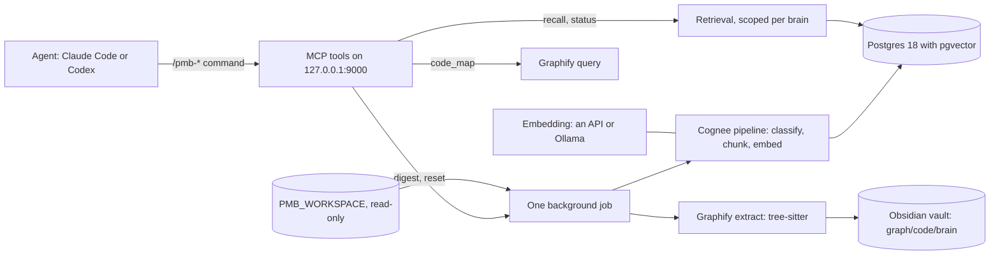

# PlugMyBrain


A plug-and-play memory for coding agents, served entirely over MCP. Point it at a folder of markdown and that folder becomes a brain the agent searches, plus a code map it reads instead of grepping the tree. **Everything runs from `/pmb-*` slash commands, and there is no chat model anywhere in it**: the agent asking the question already has one.

It exists because an agent with no memory relearns the same context every session and pays for that in tokens every time, and because a memory kept inside one vendor's product is lost the day you switch models.

## Table of Contents

1. [Setup](#setup)
2. [Usage](#usage)
3. [How It Works](#how-it-works)
4. [Why It Holds Up](#why-it-holds-up)
5. [Embeddings Come From an API or From Ollama](#embeddings-come-from-an-api-or-from-ollama)
6. [Configuration](#configuration)
7. [Data](#data)
8. [Postgres Can Live on a VM](#postgres-can-live-on-a-vm)
9. [Project Structure](#project-structure)
10. [Development](#development)
11. [Known Limitations](#known-limitations)
12. [License](#license)

## Setup

Five steps, once per machine. After step 3 nothing is typed into a terminal again: every operation is a slash command.

**1. Prerequisites.** Docker Desktop, Obsidian, Claude Code or Codex, and any Python from 3.10 for the one-time wiring. For embeddings, either an API key (Voyage by default) or [Ollama](https://ollama.com) installed on this machine.

**2. Configuration.** Copy the template and fill it in by hand.

```bash
git clone https://github.com/rahfianugerah/plugmybrain.git
cd plugmybrain
cp .env.example .env
```

Three things to set: `PMB_WORKSPACE`, `DB_PASSWORD`, and one of the two embedding blocks, an API or Ollama. Names and their meaning are in [Configuration](#configuration).

**`PMB_WORKSPACE` must contain every folder you want remembered.** The server mounts it read-only and can see nothing else. A folder outside it is refused with `is outside PMB_WORKSPACE`, so point it at the parent of all your projects, such as `C:/Users/you`.

**3. Start it from the agent.** Open Claude Code in this checkout and type:

```text
/pmb-setup
```

The agent checks that `.env` exists without opening it, pulls the Ollama model if you chose one, builds and starts the stack, registers the server with Claude Code and Codex, and installs the `/pmb-*` commands. The same thing without Claude Code is two commands:

```bash
docker compose up -d --build
python -m plugmybrain.bootstrap
```

**Run compose from this checkout, and never name the file with `-f`.** Compose only reads `compose.override.yaml` when it finds the file itself, so `-f compose.yaml` drops the override and recreates Postgres on port 5432, which a development machine usually already owns.

**`.env` has to exist first.** Without it `docker compose up` stops with `env file ... not found`, and without `PMB_WORKSPACE` with `set PMB_WORKSPACE in .env`. That is deliberate: a server started on defaults would quietly serve the wrong database or no folders at all.

**4. Restart Claude Code and Codex.** Both load servers and commands only at start.

**5. Give each folder a role, and digest it.** In the agent, from inside the folder:

```text
/pmb-init brain
/pmb-digest
```

Then open the vault in Obsidian (`PMB_DOCS`, the sibling `docs` checkout by default). The code map sits under `graph/code/<brain>/`, next to the notes a person wrote.

## Usage

Type `/pmb` in the agent and the commands complete. Each one is a markdown prompt that tells the agent which MCP tool to call, so the same commands work in Claude Code and in Codex.

| Command | Does |
| :- | :- |
| `/pmb-setup` | Once per machine, from this checkout: starts the stack, wires both agents, installs the commands |
| `/pmb-init root\|brain [folder]` | Writes the folder's one-word `.pmb` role, and scaffolds `memory/` for a brain |
| `/pmb-digest [folder]` | Chunks and embeds the folder's markdown into the memory named after it, and maps its code |
| `/pmb-status [folder]` | Markdown on disk against what was digested, every memory in the database, the embedding model, and the running job |
| `/pmb-recall <question>` | Answers only from the memory, with the source file for every claim |
| `/pmb-code [question]` | Asks the Graphify code map where something lives; with no question, the codebase's hubs |
| `/pmb-map [brain]` | Switches which memory this session reads from |
| `/pmb-memory-digest` | Writes what the session learned as one note in `memory/`, then digests it |
| `/pmb-memory-no-digest` | Writes the note only, for a batch of notes or a review before digesting |
| `/pmb-reset [folder\|all]` | Deletes a memory from the database after asking you. Never touches a markdown file |

**Asking a question needs no command.** The server's instructions tell the agent to call `recall` before answering anything about a project's rules or history. `/pmb-recall` is for when the memory must be the only source.

The commands are thin. The work is six MCP tools, which any MCP client can call directly:

| Tool | Writes | Does |
| :- | :- | :- |
| `recall(query, brain, top_k)` | Nothing | Passages from one brain, or several comma-separated, each with the file it came from |
| `brains()` | Nothing | Every memory and its document count |
| `status(folder)` | Nothing | What `/pmb-status` shows |
| `code_map(brain, question)` | Nothing | Graphify's answer from the folder's code map |
| `digest(folder, wait_seconds)` | The index and the vault | Starts a digest in the background and returns the report when it ends |
| `reset(folder, confirm, everything)` | The index and the vault | Deletes a memory; `confirm` must repeat the brain name |

**A long digest is waited on, not timed out.** `digest` returns within 45 seconds, under Codex's default tool timeout. If the job is still running it says so, and calling `digest` again with the same folder keeps waiting on the same job instead of starting another.

## How It Works



One Docker stack runs two containers: Postgres, and the MCP server. The server is the only process an agent talks to, and it does everything: it answers searches from Postgres, runs digests as a background subprocess, and queries the code map.

**The folder is the unit, and its name is the memory.** `docs/` becomes the memory `docs`; a `.pmb` file holding `root` makes every child its own memory, rules first. One database holds every memory, and `brain` on each call chooses which one answers.

### What Cognee Does Here

Cognee is the ingestion and retrieval engine. On a digest it reads each markdown file, classifies it, splits it into chunks of about 1,500 characters, embeds every chunk, and stores the text, the vectors and the document links in Postgres, which holds the relational, vector and graph stores at once. On `recall` it embeds the question and returns the nearest chunks.

PlugMyBrain runs three of Cognee's five default pipeline steps. The step it removes, `extract_graph_and_summarize`, is the only one that calls a chat model, and it was the whole bill: structured JSON per chunk, roughly $9 for a 3.6MB corpus. Without it Cognee is a chunker, an embedder and a store, which is all retrieval needs.

Two things Cognee does not do, so PlugMyBrain does them:

- **Scoping a search to one brain.** Cognee keeps every memory in one vector collection and its `datasets` argument does not filter a search. `recall` over-fetches, then keeps only chunks whose document id belongs to the requested brain in Postgres. By id rather than by file name, so two brains that both hold a `README.md` never answer for each other.
- **The vector index.** Cognee creates vector tables with no index. After every digest PlugMyBrain gives each table the index its row count deserves: exact search below 10,000 rows, where an approximate index is slower, and IVFFlat above it.

### What Graphify Does Here

Graphify builds the code map. On every digest it parses the folder's source with tree-sitter, locally and with no model, into a graph of files, classes, functions, imports and calls, then clusters it into communities and writes a report. The raw `graph.json` stays in this checkout's `graph/<brain>/`, and the report is copied into the vault so Obsidian shows it beside the notes.

`code_map` queries that graph. A question returns the code that answers it and how it connects; no question returns the most connected nodes, the hubs that explain an unfamiliar codebase fastest. An agent reads that instead of walking the tree, so finding where something lives costs no model tokens and no grep output.

**Cognee answers "what do we know about X". Graphify answers "where in the code is X".** Markdown goes to Cognee and source goes to Graphify, so source code is never sent to an embedding API.

### The Markdown Is the Memory

Postgres and the code map are indexes. Delete either and a digest rebuilds it from the files. Nothing writes into Cognee except a digest of a file on disk, so a note an agent wants to keep is written as markdown into the folder's `memory/` by `/pmb-memory-digest`, reviewed like any other file, and committed.

The server mounts `PMB_WORKSPACE` read-only. It cannot change a project even by mistake; its only writes are the database and the vault's `graph/`.

## Why It Holds Up

- **No terminal after setup.** Digest, status, reset, recall and the code map are all MCP tools behind slash commands. Nobody types `docker` again.
- **Nothing to pay per question.** Retrieval embeds the question and reads Postgres. With Ollama, digesting costs nothing either.
- **Portable across models.** The memory is markdown in git. Switching agent, embedding model or database costs a reindex, not a migration, and a model that has never seen this project reads the same files.
- **Sourced answers.** Every passage carries the file it came from, and an empty result says so rather than letting the agent guess.
- **Small surface, on purpose.** Six tools, four of them read-only. Every tool an agent can see costs context on every turn, which is why Cognee's own MCP server, with eleven tools and three that write into the index behind the markdown's back, was replaced.
- **Safe by construction.** A read-only workspace, a secret exclusion list applied before anything is embedded, loopback-only ports, a confirmation that must repeat the brain name before a reset, and a refusal to mix two embedding models in one database.
- **One stack, many memories.** Every project on the machine lives in one database; switching is a word on the next call, not a restart.
- **Obsidian as the window.** The notes a person wrote and the code maps a digest generated sit in one vault and one graph view.

## Embeddings Come From an API or From Ollama

The embedding model is the only model in PlugMyBrain. Pick one in `.env`:

| | API | Ollama |
| :- | :- | :- |
| `EMBEDDING_PROVIDER` | `voyage`, or any LiteLLM embedding provider | `ollama` |
| `EMBEDDING_MODEL` | `voyage/voyage-3.5` | `bge-m3`, after `ollama pull bge-m3` |
| `EMBEDDING_DIMENSIONS` | `1024` | `1024` |
| `EMBEDDING_API_KEY` | Required | Not used |
| `EMBEDDING_ENDPOINT` | Only for an Atlas-issued Voyage key | `http://host.docker.internal:11434/api/embed`, the default |
| Text leaves the machine | Yes, every chunk | No |
| Cost | Per token; the Voyage free tier covers a personal corpus | None |

Ollama runs on the host and the server reaches it through `host.docker.internal`, which compose maps on Linux as well as on Docker Desktop. `bge-m3` is the suggested local model: 1024 dimensions, multilingual, and an 8,192-token context.

**Changing the model means re-embedding everything.** Vectors from two models rank each other wrong without any error, so the server records which model built the database and refuses a digest or a search with another one. To switch, run `/pmb-reset all`, change `.env`, restart the stack, and `/pmb-digest` again.

**Keep `EMBEDDING_DIMENSIONS` at 2000 or below.** pgvector will not index a wider vector, and it does not fail loudly: every search becomes a sequential scan. The server refuses to start above it.

## Configuration

Every variable the project reads. Names only; the values live in `.env`, which is never committed.

| Variable | Required | Description |
| :- | :- | :- |
| `PMB_WORKSPACE` | Yes | Absolute path of the folder holding every project to remember. Mounted read-only |
| `DB_PASSWORD` | Yes | Postgres password |
| `DB_NAME` `DB_USERNAME` | Yes | Postgres database and user. `plugmybrain` by default |
| `DB_HOST` `DB_PORT` | No | Postgres as the host sees it, for the development CLI. Compose sets the server's own |
| `EMBEDDING_PROVIDER` `EMBEDDING_MODEL` | Yes | The embedding model. See [Embeddings](#embeddings-come-from-an-api-or-from-ollama) |
| `EMBEDDING_DIMENSIONS` | Yes | `1024`. Above 2000 the server refuses to start |
| `EMBEDDING_API_KEY` | For an API | The embedding provider's key |
| `EMBEDDING_ENDPOINT` | No | An Atlas-issued Voyage key, or a non-default Ollama address |
| `EMBEDDING_RATE_LIMIT_*` `EMBEDDING_BATCH_SIZE` | No | Throttling, for the Voyage free tier without a payment method |
| `PMB_DOCS` | No | The Obsidian vault generated notes go into. Defaults to the sibling `docs` checkout |
| `MCP_PUBLISH_PORT` | No | Host port for the MCP server. Default `9000` |
| `DB_PUBLISH_PORT` | No | Host port for Postgres. `15432` on a laptop through `compose.override.yaml` |
| `PMB_DB_HOST` `PMB_DB_PORT` | No | Postgres somewhere else, such as a VM through the tunnel |
| `POOL_ARGS` `VECTOR_POOL_ARGS` | No | Connection pool sizing |
| `CHUNK_SIZE` `CHUNK_OVERLAP` | No | Characters per chunk, and the overlap |
| `PMB_INDEX` `PMB_INDEX_THRESHOLD` | No | `auto`, `exact`, `ivfflat` or `hnsw`, and the row count where `auto` switches |
| `BACKUP_BUCKET` `BACKUP_KEEP_DAYS` | No | VM only. Nightly `pg_dump` target and retention |
| `PMB_VM` `PMB_ZONE` `PMB_PROJECT` | No | Laptop only, for `scripts/tunnel.ps1` |

| Port | Service | Bound to |
| :- | :- | :- |
| `9000` | MCP server, streamable HTTP at `/mcp` | `127.0.0.1` |
| `15432` | Postgres on a laptop, `5432` on a VM | `127.0.0.1` |

## Data

| Item | Location | Notes |
| :- | :- | :- |
| The memory itself | `<folder>/memory/` | Committed in that folder's repository. Human-authored, the source of truth |
| Folder role | `<folder>/.pmb` | Committed, so a clone on another machine knows the layout |
| Chunks and vectors | Docker volume `pmb-pgdata` | Rebuilt by a digest |
| Cognee system state | Docker volume `pmb-cognee` | Rebuilt by a digest |
| Code map, raw | `graph/<brain>/` in this checkout | Gitignored. Rebuilt by a digest |
| Code map report | `<vault>/graph/code/<brain>/` | Gitignored in the vault. Rebuilt by a digest, deleted by a reset |
| `.env` | This checkout | Gitignored. Holds the keys |

## Postgres Can Live on a VM

The default is everything on the laptop. When the database should outlive the laptop, Postgres moves to a small always-on VM and **the server stays on the laptop**, because it has to read the folders it digests.

On the VM, from a checkout with its own `.env` (mode `600`):

```bash
sudo bash scripts/provision-vm.sh
sudo docker compose up -d postgres
```

`provision-vm.sh` adds swap, refuses a disk under 25GB, enables Docker at boot and sets the timezone. Nothing on the VM listens beyond loopback; the only way in is SSH through IAP.

On the laptop, open the tunnel and point the server at it:

```powershell
$env:PMB_VM="plugmybrain"; $env:PMB_ZONE="asia-southeast1-a"; $env:PMB_PROJECT="your-project"
.\scripts\tunnel.ps1
```

Then set `PMB_DB_HOST=host.docker.internal` and `PMB_DB_PORT=25432` in `.env`, and start only the server:

```bash
docker compose up -d --no-deps mcp
```

`scripts/backup.sh` runs a nightly `pg_dump` to a GCS bucket from cron on the VM and exits non-zero on an empty dump or a nearly full disk. **Restore once into a scratch database before trusting it.** The markdown remains the real backup: the whole database comes back from a digest.

## Project Structure

```text
plugmybrain/
  server.py      # the MCP server: six tools, and the only thing an agent talks to
  jobs.py        # one background digest or reset at a time, as a subprocess
  ingest.py      # Cognee add, chunk and embed, then the vector index
  retrieve.py    # search scoped to a brain by document id
  manage.py      # status, reset, and the embedding model guard
  config.py      # paths, folder roles, workspace mapping, the exclusion list, startup checks
  cli.py         # what a job runs inside the container: digest, list, reset
  bootstrap.py   # once per machine: wires Claude Code and Codex, installs the commands
commands/        # the /pmb-* slash commands, installed into both agents
.claude/commands/pmb-setup.md   # /pmb-setup, available inside this checkout
compose.yaml     # postgres and the mcp server
scripts/         # provision-vm.sh, tunnel.ps1, backup.sh, init-pgvector.sql
tests/
docs/PRD.md      # what this is for, and what it deliberately is not
```

## Development

Conda, an environment named `env`, Python 3.13. The image does not need it; it is for tests and the linter.

```bash
conda env update -f environment.yml
conda activate env
pip install -e .
ruff check .
ruff format .
pytest
```

A change to the server is live after `docker compose up -d --build`. A change to a command in `commands/` is live after `python -m plugmybrain.bootstrap` and an agent restart.

The branches follow a promotion path, `dev` to `staging` to `main`. See [CONTRIBUTING.md](CONTRIBUTING.md).

## Known Limitations

- **Only markdown is digested.** PDF, docx and csv are not read. Convert them first.
- **There is no entity graph.** `recall` matches text within documents. A question answered only by traversing between documents is not answered; Graphify covers that for code, and for prose it is the price of having no chat model.
- **The server sees only `PMB_WORKSPACE`.** A folder elsewhere is refused. Widening it means editing `.env` and recreating the server, and everything inside it becomes readable by the container.
- **One job at a time.** A second digest or a reset while one runs is refused with `Busy`. Searches still work during a digest.
- **The embedding model is locked to the database.** Changing it is a full reset and re-digest; the server refuses to mix two.
- **A database digested before this guard existed is not protected.** The first digest records whichever model is configured at that moment, so switch models only after `/pmb-reset all`.
- **The secret filter matches names, not contents.** `.env`, keys and credential files are never read, but a secret pasted into an ordinary `.md` is embedded like any other text, and with an API it leaves the machine.
- **The first corpus gets no vector index, on purpose.** Below 10,000 chunks exact search is faster than IVFFlat. `/pmb-digest` reports which index each table got and why.
- **HNSW is opt-in and wants about 4 GiB to build.** On a 2 GiB machine the build is what gets killed. Set `PMB_INDEX=hnsw` only after resizing.
- **Postgres-as-graph is a Cognee demo feature.** It is used so one database holds every store. If it proves unstable, `GRAPH_DATABASE_PROVIDER=kuzu` works locally with no other change.
- **`host.docker.internal` reaches loopback ports only on Docker Desktop.** On Linux the remote-Postgres setup needs the tunnel bound to the Docker bridge instead.
- **No temporal layer.** Nothing here answers "what did I know in March". Git history does.

## License

To be confirmed.
